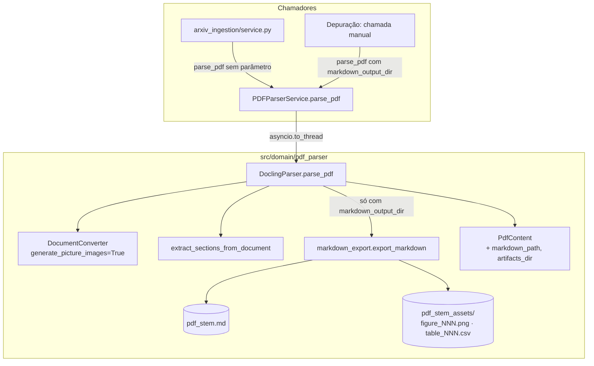

# Architecture: TASK-001

> 📁 **Sessão**: `.jarvis/sessions/eng/task-001/`
> 🎫 **Chave**: `TASK-001` (modo freelance, sem board)

> **Criado em:** 2026-10-26  
> **Issue:** [TASK-001](../../../../docs/jarvis/product/issues/task-001-exportacao-markdown-pdf-parser.md)  
> **Branch base:** main (branch de trabalho: `TASK-001-exportacao-markdown-pdf-parser`)  
> **Status:** ✅ Aprovado  
> **Advisor:** não utilizado  
> **Questões em aberto:** tratar no architecture.md (como hoje)

---

## 1. Visão Geral

### 1.1 Contexto

O `production-rag` converte artigos do arXiv com o Docling no domínio `src/domain/pdf_parser/`. Hoje o `PdfContent` guarda só `raw_text` e `sections`; figuras e tabelas são descartadas (`figures=[]`, `tables=[]` em `src/domain/pdf_parser/docling.py:183-184`). Quem depura a qualidade do parsing não tem uma visão do artigo com figuras e tabelas preservadas.

A [TASK-001](../../../../docs/jarvis/product/issues/task-001-exportacao-markdown-pdf-parser.md) (prioridade Alta) acrescenta uma exportação **opcional** para Markdown com assets. A investigação está no [discovery-001](../../../../docs/jarvis/discoveries/discovery-001-exportacao-markdown-pdf-parser.md) (veredito `proceed`): o uso é **revisão humana e depuração**, a ingestão não muda e `generate_picture_images` fica sempre ligado.

### 1.2 Objetivo

Quando `parse_pdf` recebe `markdown_output_dir`, o parser grava `{pdf_stem}.md` e `{pdf_stem}_assets/` (figuras `figure_NNN.png` e tabelas `table_NNN.csv`) e devolve os caminhos em `PdfContent.markdown_path` e `PdfContent.artifacts_dir`. Sem o parâmetro, o comportamento é o de hoje.

### 1.3 Escopo

**Incluído:**

- Parâmetro `markdown_output_dir: Path | None = None` em `DoclingParser.parse_pdf` e `PDFParserService.parse_pdf` (repasse)
- `generate_picture_images=True` nas pipeline options do `DoclingParser`
- Módulo novo `src/domain/pdf_parser/markdown_export.py` com a montagem em passada única por `doc.iterate_items()` e a gravação de `.md`, PNGs e CSVs
- Campos `markdown_path` e `artifacts_dir` em `PdfContent`
- Testes unitários com documentos falsos e teste de integração com o PDF fixture `tests/fixtures/arxiv_pdfs/2609.17429v1.pdf`

**Não incluído:**

- Passar o parâmetro na ingestão (`src/domain/arxiv_ingestion/service.py:441`) ou no DAG do Airflow
- CLI ou endpoint para a exportação
- Persistir Markdown, figuras ou CSVs no PostgreSQL ou no OpenSearch, ou usá-los no RAG
- Configurar `images_scale` ou ligar/desligar `generate_picture_images` por configuração
- Imagens de páginas inteiras ou imagens das tabelas; preencher `PdfContent.figures`/`tables`
- Baixar o PDF fixture (fornecido pelo usuário, ver 4.3)

### 1.4 Critérios de Sucesso

- [ ] Os 23 critérios de aceitação da TASK-001 atendidos
- [ ] Chamada sem `markdown_output_dir` retorna o mesmo `PdfContent` de hoje (campos novos `None`) e não grava arquivos
- [ ] Teste de integração com o PDF fixture gera `.md`, `figure_001.png`… e `table_001.csv`…, com link para cada figura e um CSV por tabela
- [ ] `make lint` e `make test` passam (sem CI no repositório: validação local)

---

## 2. Análise Técnica

### 2.1 Estado Atual (As-Is)

```
Fluxo atual (DoclingParser.parse_pdf, src/domain/pdf_parser/docling.py:158):
1. _validate_pdf(pdf_path): tamanho, header %PDF-, número de páginas (pypdfium2)
2. self._converter.convert(...) com PdfPipelineOptions(do_table_structure, do_ocr)   ← docling.py:94-99
3. sections = extract_sections_from_document(doc)                                    ← passada por iterate_items()
4. return PdfContent(sections, figures=[], tables=[], raw_text=doc.export_to_text(), ...)
5. PDFValidationError de limite → None; outros erros → PDFParsingException

PDFParserService.parse_pdf (parser.py:22): asyncio.to_thread(self.docling_parser.parse_pdf, pdf_path)
Consumidores: arxiv_ingestion/service.py:441 (parse_pdf(pdf_path)), main.py:45 (app.state.pdf_parser)
```

### 2.2 Estado Proposto (To-Be)

```
DoclingParser.parse_pdf(pdf_path, markdown_output_dir=None):
1. _validate_pdf(pdf_path)                                         (sem mudança)
2. convert(...) com PdfPipelineOptions(..., generate_picture_images=True)
3. sections = extract_sections_from_document(doc)                  (sem mudança)
4. se markdown_output_dir:
     markdown_path, artifacts_dir = export_markdown(doc, pdf_path.stem, markdown_output_dir)
       a. mkdir(markdown_output_dir / f"{stem}_assets", parents=True, exist_ok=True)
       b. UMA passada por doc.iterate_items():
          - TITLE/SECTION_HEADER → "#"*nível; LIST_ITEM → "- "; CODE → bloco cercado; demais textos → parágrafo
          - PICTURE → figure_counter += 1; get_image(doc).save(figure_NNN.png); alt pela regra; ""
          - TABLE   → table_counter += 1; GFM inline no .md; table_NNN.csv do mesmo grid (UTF-8, ",", QUOTE_MINIMAL, regra de header)
       c. grava {stem}.md (UTF-8)
5. return PdfContent(..., markdown_path=markdown_path, artifacts_dir=artifacts_dir)

PDFParserService.parse_pdf(pdf_path, markdown_output_dir=None):
   asyncio.to_thread(self.docling_parser.parse_pdf, pdf_path, markdown_output_dir)
```

A regra do `alt` (próximo `CAPTION` iniciado com "Figure") exige olhar adiante na sequência: a passada coleta `(item, depth)` numa lista (`list(doc.iterate_items())`) e percorre por índice, o que continua sendo uma única montagem guiada por `iterate_items()`.

### 2.3 Componentes Impactados

| Componente | Caminho | Tipo de Mudança | Descrição da Mudança |
| ---------- | ------- | --------------- | -------------------- |
| Exportação Markdown | `production-rag/src/domain/pdf_parser/markdown_export.py` | 🆕 Criação | `export_markdown(doc, pdf_stem, output_dir) -> tuple[Path, Path]` + funções puras de renderização (texto, figura, tabela), regra do `alt` e escrita do CSV |
| DoclingParser | `production-rag/src/domain/pdf_parser/docling.py` | ✏️ Modificação | `generate_picture_images=True` em `PdfPipelineOptions` (l. 94-97); parâmetro `markdown_output_dir` em `parse_pdf` (l. 158); chamada a `export_markdown` depois de `extract_sections_from_document` (l. 178); campos novos no `PdfContent` retornado (l. 181) |
| PDFParserService | `production-rag/src/domain/pdf_parser/parser.py` | ✏️ Modificação | Parâmetro `markdown_output_dir` em `parse_pdf` (l. 22) e repasse no `asyncio.to_thread` (l. 33) |
| PdfContent | `production-rag/src/domain/pdf_parser/models.py` | ✏️ Modificação | `markdown_path: Optional[Path] = Field(default=None, ...)` e `artifacts_dir: Optional[Path] = Field(default=None, ...)` (l. 36-45) |
| Testes unitários | `production-rag/tests/unit/domain/pdf_parser/test_markdown_export.py` | 🆕 Criação | Documentos falsos (`SimpleNamespace`): contadores, `alt`, header do CSV, renderização de texto, sem parâmetro não grava nada |
| Testes do serviço | `production-rag/tests/unit/domain/test_pdf_parser.py` | ✏️ Modificação | Repasse de `markdown_output_dir` no `PDFParserService` (mock do `DoclingParser.parse_pdf`, padrão já usado no arquivo) |
| Teste de integração | `production-rag/tests/integration/pdf_parser/test_markdown_export.py` | 🆕 Criação | `parse_pdf` real com o PDF fixture e `tmp_path` |
| PDF fixture | `production-rag/tests/fixtures/arxiv_pdfs/2609.17429v1.pdf` | 🆕 Criação | Fornecido pelo usuário; commitado no fork (`origin`) |

### 2.4 Padrões e Convenções a Seguir

| Padrão | Descrição | Referência no Projeto |
| ------ | --------- | --------------------- |
| Organização por domínio | Código novo dentro de `src/domain/pdf_parser/`, sem pastas por camada técnica | `production-rag/AGENTS.md` |
| Passada por `iterate_items()` | Mesmo estilo de `extract_sections_from_document` (`label` via `getattr`, texto `.strip()`) | `src/domain/pdf_parser/docling.py:27-79` |
| Labels do Docling | `DocItemLabel` de `docling_core.types.doc` | `src/domain/pdf_parser/docling.py:9,16-24` |
| Modelos Pydantic | `Field(default=..., description=...)` em todo campo | `src/domain/pdf_parser/models.py` |
| Erros do domínio | `PDFParsingException` / `PDFValidationError` | `src/domain/pdf_parser/exceptions.py` |
| Logs | `logger = logging.getLogger(__name__)`; preferir `%s` (lazy) | `src/domain/rerank/service.py`, skill `eng-backend-python-fastapi` |
| Testes com documento falso | `SimpleNamespace(iterate_items=lambda: iter([...]))` | `tests/unit/domain/pdf_parser/test_docling_sections.py` |
| Testes assíncronos | `asyncio_mode = "auto"` | `pyproject.toml` |
| Lint | Ruff, linha de 130 colunas, ordenação de imports | `pyproject.toml` |

---

## 3. Decisões Arquiteturais

### 3.1 Decisão: Exportação em módulo próprio, com regras puras separadas da gravação

**Contexto:**  
`DoclingParser.parse_pdf` já concentra validação, conversão e tratamento de erros (`docling.py:158-226`). A exportação tem regras finas (contadores, `alt`, header do CSV) que precisam de testes rápidos, sem carregar os modelos do Docling.

**Opções Consideradas:**

| Opção | Descrição | Prós | Contras |
| ----- | --------- | ---- | ------- |
| A | Módulo `markdown_export.py` com funções puras de renderização + uma função que grava | Testável com `SimpleNamespace`, `parse_pdf` continua legível, segue o padrão de `extract_sections_from_document` | Um arquivo novo |
| B | Métodos privados dentro do `DoclingParser` | Tudo num arquivo | `docling.py` cresce; testar exige instanciar o parser |

**Decisão:** A

**Justificativa:**  
É o mesmo desenho de `extract_sections_from_document` (função de módulo que recebe o `doc`), já testado com documentos falsos em `test_docling_sections.py`.

**Consequências:**

- Regras de numeração, `alt` e CSV testadas em milissegundos
- A integração real com o Docling fica coberta só pelo teste com o PDF fixture

---

### 3.2 Decisão: Implementar a regra do `alt` ao pé da letra, sem spike prévio

**Contexto:**  
A documentação do Docling indica que a legenda pode ser filha da figura (`picture.caption_text(doc)`) e `iterate_items()` não entra em filhos de figuras por padrão. Isso não pôde ser confirmado sem rodar o Docling (fora do escopo do `eng.start`).

**Opções Consideradas:**

| Opção | Descrição | Prós | Contras |
| ----- | --------- | ---- | ------- |
| A | Spike na fase 1 do `eng.work` para inspecionar o PDF fixture | Regra fechada com dado real | Uma fase a mais |
| B | Implementar direto (próximo `CAPTION` no `iterate_items()` padrão) e ajustar se o teste com o PDF real falhar | Mais rápido; fiel à tarefa | Risco R1 |

**Decisão:** B (escolha do usuário no `eng.start`)

**Justificativa:**  
Seguir a tarefa como escrita; o teste de integração com o PDF fixture detecta o problema (ver 6.5 e Q1).

**Consequências:**

- O teste de integração precisa verificar que pelo menos uma figura recebeu `alt` vindo de um caption, para o risco R1 aparecer como falha e não passar em silêncio
- Se R1 se confirmar, a correção é uma questão nova no `eng.work`

---

### 3.3 Decisão: Campos novos de `PdfContent` como `Optional[Path]`

**Contexto:**  
`PdfContent` é instanciado na ingestão e nos testes; a ingestão copia campo a campo (`service.py:501-512`) e não persiste o modelo inteiro.

**Opções Consideradas:**

| Opção | Descrição | Prós | Contras |
| ----- | --------- | ---- | ------- |
| A | `Optional[Path] = None` | Tipo fiel ao parâmetro `Path`; não quebra quem instancia | Serializa como string em `model_dump(mode="json")` |
| B | `Optional[str] = None` | Serialização trivial | Perde o tipo; conversões nos chamadores |

**Decisão:** A

**Justificativa:**  
O parâmetro já é `Path`, nada persiste esses campos e o padrão `None` mantém compatibilidade com `service.py` e `tests/unit/domain/arxiv_ingestion/test_metadata_fetcher.py`.

**Consequências:**

- Nenhum chamador existente precisa mudar

---

### 3.4 Decisão: Teste com o PDF real em `tests/integration/`

**Contexto:**  
O teste com o PDF fixture roda o Docling de verdade (lento, baixa modelos na primeira execução). O repositório não usa markers de pytest.

**Decisão:** `tests/integration/pdf_parser/test_markdown_export.py`, rodando no `make test` (escolha do usuário).

**Consequências:**

- `make test` fica mais lento e passa a depender dos modelos do Docling disponíveis no ambiente

---

## 4. Dependências

### 4.1 Dependências Internas

| Módulo/Componente | Motivo da Dependência | Status |
| ----------------- | --------------------- | ------ |
| `src/domain/pdf_parser/docling.py` | Ponto de chamada da exportação e pipeline options | ✅ Existe |
| `src/domain/pdf_parser/models.py` | `PdfContent` com os campos novos | ✅ Existe |
| `src/domain/pdf_parser/exceptions.py` | `PDFParsingException` em falha de gravação | ✅ Existe |

### 4.2 Dependências Externas

| Biblioteca/Serviço | Versão | Motivo | Já existe no projeto? |
| ------------------ | ------ | ------ | --------------------- |
| `docling` | 2.52.0 (`uv.lock`) | `PdfPipelineOptions.generate_picture_images`, `DocumentConverter` | ✅ Sim |
| `docling-core` | 2.48.1 (`uv.lock`) | `DocItemLabel`, `iterate_items()`, `PictureItem.get_image(doc)`, `TableItem.export_to_markdown(doc)` | ✅ Sim |
| `csv` (stdlib) | — | `csv.writer(..., quoting=csv.QUOTE_MINIMAL)` | ✅ Sim |
| Pillow | via `docling` | `PIL.Image.save(..., "PNG")` do retorno de `get_image` | ✅ Sim (transitiva) |

### 4.3 Dependências de Outras Tasks

| Task | Descrição | Status |
| ---- | --------- | ------ |
| PDF fixture (usuário) | `tests/fixtures/arxiv_pdfs/2609.17429v1.pdf` colocado pelo usuário, com licença conferida e até 30 páginas (`PDF_PARSER__MAX_PAGES`) | 🔄 Pendente: bloqueia o teste de integração |
| Ambiente local | `make setup` (`uv sync`) para instalar o Docling; hoje não há `.venv` | 🔄 Pendente: necessário no `eng.work` |

---

## 5. Riscos e Mitigações

| ID | Risco | Probabilidade | Impacto | Mitigação | Plano B |
| -- | ----- | ------------- | ------- | --------- | ------- |
| R1 | `CAPTION` é filho da figura e `iterate_items()` padrão não o visita: todo `alt` vira `Figure NNN` | Média | Médio | Q1 decidida (opção 3): fallback para `picture.caption_text(doc)`; teste de integração exige ao menos um `alt` vindo de caption "Figure" | `iterate_items(traverse_pictures=True)` só na passada da exportação, filtrando textos internos de gráficos |
| R7 | Figura sem legenda recebe a legenda "Figure…" de outra figura da mesma seção (Q2, opção 4) | Baixa | Baixo | Mitigado pela Q5: cada legenda é usada por uma figura só; resta o caso de uma figura cuja legenda própria não foi visitada pegar a da seguinte (documentado em teste) | Parar a busca também no próximo `PICTURE` |
| R2 | `get_image(doc)` retorna `None` para alguma figura | Baixa | Médio | Q4 define o comportamento antes de implementar | Log de aviso e seguir |
| R3 | Formato do grid sem cabeçalho não é o esperado (quando o Docling emite tabela sem linha separadora) ou células com `\|` escapado quebram a leitura do GFM | Média | Baixo | Q3 decidida (opção 1): CSV derivado do mesmo texto GFM inline, então header e dados sempre espelham o `.md`; tratar `\|` escapado ao separar células | Ajustar o parser do GFM com o caso real do fixture |
| R4 | `generate_picture_images=True` aumenta tempo e memória de toda a ingestão | Alta | Médio | Medir o parsing de um lote antes e depois (subtarefa 8 da TASK-001) | Abrir tarefa para tornar a opção configurável (fora do escopo) |
| R5 | PDF fixture acima de 30 páginas ou com licença que não permite redistribuição | Baixa | Alto | Usuário confere antes de fornecer (4.3) | Escolher outro artigo do arXiv com licença aberta |
| R6 | `make test` passa a depender dos modelos do Docling (download na primeira execução, sem rede falha) | Média | Médio | Documentar no PR que o primeiro `make test` baixa modelos | Marcar o teste com `pytest.importorskip`/skip quando o modelo não estiver disponível (exigiria nova decisão) |

---

## 6. Considerações Técnicas

### 6.1 Segurança

- **Autenticação/Autorização:** não se aplica (sem endpoint novo).
- **Validação de Dados:** o caminho dos arquivos vem só de `markdown_output_dir`, `pdf_path.stem` e contadores; nenhum texto do documento vira caminho. O `.md` é texto do próprio PDF, sem execução.
- **Dados Sensíveis:** artigos públicos do arXiv; sem PII nem credenciais.
- **OWASP:** sem superfície de segurança identificada além de gravar só dentro de `markdown_output_dir`.

### 6.2 Performance

- **Latência esperada:** sem meta definida; uso de depuração.
- **Throughput:** não se aplica.
- **Otimizações planejadas:** nenhuma; a exportação só roda com o parâmetro.
- **Pontos de atenção:** `generate_picture_images=True` sempre ligado (R4) afeta a ingestão inteira.

### 6.3 Escalabilidade

- **Como escala horizontalmente:** sem mudança; o parsing continua em `asyncio.to_thread` com o semáforo da ingestão.
- **Limitações conhecidas:** a exportação grava no disco local do processo.

### 6.4 Observabilidade

- **Logs necessários:** `info` ao terminar a exportação (caminho do `.md`, número de figuras e tabelas); `warning` quando uma figura não tem imagem (Q4); `error` em falha de gravação antes de levantar `PDFParsingException`.
- **Métricas:** nenhuma nova.
- **Alertas:** nenhum.

### 6.5 Estratégia de Testes

> Sem requisitos de performance ou segurança explícitos: o `eng.qa.test-architect` não foi acionado.

#### 6.5.1 Tipos de Teste Necessários

| Tipo de Teste | O que testar | Cobertura Mínima | Prioridade |
| ------------- | ------------ | ---------------- | ---------- |
| Unitário | `markdown_export.py`: contadores separados a partir de 001; `alt` com e sem caption "Figure"; GFM inline sem link para CSV; CSV UTF-8/vírgula/`QUOTE_MINIMAL`; CSV com e sem header; títulos, listas e código; ordem pela visita | Todos os critérios de aceitação de Figuras, Tabelas e Montagem | Alta |
| Unitário | `PDFParserService.parse_pdf` repassa `markdown_output_dir`; `parse_pdf` sem parâmetro não grava nada e devolve campos `None` | Critérios de Parâmetro e compatibilidade | Alta |
| Integração | `DoclingParser.parse_pdf` real com o PDF fixture e `tmp_path`: `.md` e pasta de assets existem, nomes começam em 001, cada figura tem link, cada tabela tem CSV, ao menos um `alt` veio de caption | Critérios de Testes da TASK-001 | Alta |
| E2E | Não se aplica (sem interface) | — | — |

#### 6.5.4 Estrutura de Testes

```
production-rag/tests/
├── unit/domain/pdf_parser/test_markdown_export.py      # novo
├── unit/domain/test_pdf_parser.py                      # + repasse do parâmetro
├── integration/pdf_parser/test_markdown_export.py      # novo (Docling real)
└── fixtures/arxiv_pdfs/2609.17429v1.pdf                # fornecido pelo usuário
```

#### 6.5.5 Critérios de Aceite para Testes

- [ ] Todo critério de aceitação da TASK-001 coberto por pelo menos um teste
- [ ] Testes existentes de `pdf_parser` e `arxiv_ingestion` continuam passando
- [ ] `make lint` e `make test` passam localmente

---

## 7. Diagrama de Arquitetura



A ingestão continua no caminho de cima, sem exportar; a exportação só acontece quando quem chama passa o diretório.

---

## 8. Questões em Aberto

| ID | Questão | Opção escolhida | Responsável | Deadline | Status |
| -- | ------- | --------------- | ----------- | -------- | ------ |
| Q1 | Como tratar o `alt` se o `CAPTION` for filho da figura | ✅ 3 — Próximo CAPTION + `caption_text` | phelipperibeiro@hotmail.com | — | ✅ Decidida (substituída pela Q5) |
| Q2 | Até onde procurar o "próximo `CAPTION`" de uma figura | ✅ 4 — Até o fim da seção | phelipperibeiro@hotmail.com | — | ✅ Decidida (incorporada à Q5) |
| Q3 | De onde sai o GFM inline e o CSV de cada tabela (e como detectar o header) | ✅ 1 — GFM do `TableItem` + CSV derivado | phelipperibeiro@hotmail.com | — | ✅ Decidida |
| Q4 | O que fazer quando `get_image(doc)` não devolve imagem | ✅ 2 — Texto do `alt` em itálico | phelipperibeiro@hotmail.com | — | ✅ Decidida |
| Q5 | Legendas agrupadas ou antes da figura no PDF real (levantada no `eng.work`) | ✅ 3 — Uma vez só + olhar para trás | phelipperibeiro@hotmail.com | — | ✅ Decidida |

### Q1 — Como tratar o `alt` se o `CAPTION` for filho da figura

**Contexto:**
A tarefa diz que o `alt` vem do "próximo `CAPTION` começando com 'Figure'" na passada por `iterate_items()`. A documentação do Docling mostra legendas ligadas à figura (`picture.caption_text(doc)`) e `iterate_items()` usa `traverse_pictures=False` por padrão, ou seja, filhos de figuras não são visitados. Se a legenda for filha, a regra nunca casa e todo `alt` vira `Figure NNN` (R1). Você escolheu implementar direto, sem spike; esta questão define o que fazer se o teste com o PDF real mostrar o problema.

**Arquivos/componentes envolvidos:**
* `src/domain/pdf_parser/markdown_export.py` — regra do `alt`
* `src/domain/pdf_parser/docling.py:49` — `extract_sections_from_document` usa o `iterate_items()` padrão (não deve mudar)

**Dúvida:**
Se a legenda não for visitada pela passada padrão, qual fonte o `alt` usa?

**Opções:**

**❌ 1. Ao pé da letra, sem fallback**
* Como funciona: `iterate_items()` padrão; só o próximo `CAPTION` visitado conta.
* Vantagens: fiel à tarefa; código mais simples.
* Desvantagens: se R1 se confirmar, nenhuma figura terá `alt` de caption e o teste de integração falha.
* Impacto: nenhum código extra; possível retrabalho no `eng.work`.

**❌ 2. `iterate_items(traverse_pictures=True)` só na passada da exportação**
* Como funciona: a passada da exportação visita os filhos da figura, inclusive a legenda, que aparece logo depois dela.
* Vantagens: mantém a regra "próximo `CAPTION`" e a passada única.
* Desvantagens: também visita textos internos de gráficos (rótulos de eixos), que viram parágrafos no `.md` se não forem filtrados.
* Impacto: filtrar itens filhos de figura que não sejam `CAPTION`.

**✅ 3. Próximo `CAPTION` visitado e, se não houver, `picture.caption_text(doc)` iniciado com "Figure" (escolhida)**
* Como funciona: tenta a regra da tarefa; sem caption visitado, usa a legenda ligada à figura; senão, `Figure NNN`.
* Vantagens: cobre os dois formatos do Docling; sem textos internos de gráfico.
* Desvantagens: acrescenta uma fonte que a tarefa não cita.
* Impacto: uma chamada a mais por figura.

**❌ 4. Outra**
* Alternativa a definir.

**Sugestão do Agente Principal (Architect):**
3: preserva a regra da tarefa como primeira fonte e evita o caso em que nenhuma figura ganha legenda, sem trazer textos de gráficos para o `.md`.

**Sugestão do Sub-Agent (Advisor):**
N/A (Advisor não utilizado)

**Decisão adotada:**
✅ **3 — Próximo `CAPTION` visitado; sem ele, `picture.caption_text(doc)` iniciado com "Figure"; senão, `Figure NNN`** (decisão do usuário na revisão, 2026-10-26)

> ⚠️ **Substituída pela Q5** (levantada no `eng.work`): a regra vigente usa cada legenda uma vez só, com busca adiante, `caption_text` e busca para trás na mesma seção.

**Divergência:**
N/A (Advisor não utilizado)

**Impacto da decisão:**
Define a função do `alt` e o que o teste de integração verifica.

### Q2 — Até onde procurar o "próximo `CAPTION`" de uma figura

**Contexto:**
"Próximo `CAPTION`" não tem limite na tarefa. Sem limite, uma figura sem legenda pode receber a legenda da figura seguinte ("Figure 2…").

**Arquivos/componentes envolvidos:**
* `src/domain/pdf_parser/markdown_export.py` — busca do caption

**Dúvida:**
Qual é o limite da busca?

**Opções:**

**❌ 1. Até o próximo `PICTURE` ou `TABLE`**
* Como funciona: procura adiante e para ao encontrar outra figura ou tabela.
* Vantagens: evita roubar a legenda da figura seguinte; tolera texto entre a figura e a legenda.
* Desvantagens: um caption "Figure" muito distante ainda pode ser pego.
* Impacto: um laço com condição de parada.

**❌ 2. Só o item imediatamente seguinte**
* Como funciona: o `alt` só vem de caption se o próximo item visitado for um `CAPTION` "Figure".
* Vantagens: regra mais estrita e simples.
* Desvantagens: falha se houver qualquer item entre a figura e a legenda.
* Impacto: mínimo.

**❌ 3. Qualquer `CAPTION` adiante no documento**
* Como funciona: leitura literal, sem limite.
* Vantagens: fiel ao texto da tarefa.
* Desvantagens: figura sem legenda herda a legenda de outra figura.
* Impacto: `alt` errado em artigos com figuras sem legenda.

**✅ 4. Outra: até o fim da seção (escolhida)**
* Como funciona: procura adiante e para no próximo `TITLE` ou `SECTION_HEADER` (fim da seção atual); passa por outras figuras e tabelas da mesma seção.
* Vantagens: limita a busca à seção da figura; tolera texto, tabelas e outras figuras entre a figura e a legenda.
* Desvantagens: uma figura sem legenda pode receber a legenda "Figure…" de outra figura da mesma seção (risco aceito pelo usuário).
* Impacto: o laço de busca para em `TITLE`/`SECTION_HEADER`; a busca só olha para a frente, sem marcar legendas como "já usadas".

**Sugestão do Agente Principal (Architect):**
1: equilibra fidelidade à tarefa e risco de legenda trocada. Na revisão, foi sugerido também parar no próximo `PICTURE` além do fim da seção; o usuário preferiu só o fim da seção.

**Sugestão do Sub-Agent (Advisor):**
N/A (Advisor não utilizado)

**Decisão adotada:**
✅ **4 — Até o fim da seção (próximo `TITLE`/`SECTION_HEADER`), sem parar em outras figuras** (decisão do usuário na revisão, 2026-10-26)

> ⚠️ **Incorporada à Q5**: o limite da seção continua valendo, agora nas duas direções da busca.

**Divergência:**
N/A (Advisor não utilizado)

**Impacto da decisão:**
Define o laço de busca e testes unitários para: legenda na mesma seção depois de texto e tabela; legenda depois de um `SECTION_HEADER` não é usada (`alt` = fallback da Q1); figura sem legenda seguida de figura com legenda na mesma seção recebe a legenda da seguinte (comportamento aceito, documentado no teste). A Q1 continua valendo: sem `CAPTION` "Figure" na seção, usa `picture.caption_text(doc)` e depois `Figure NNN`.

### Q3 — De onde sai o GFM inline e o CSV de cada tabela

**Contexto:**
A tarefa exige a tabela inline em GFM e um CSV cuja primeira linha só é o header quando o grid inline tem a linha separadora. Para o CSV espelhar o `.md`, os dois precisam vir da mesma fonte. A proibição da tarefa é sobre o `export_to_markdown()` do **documento** numa passada separada; o `export_to_markdown(doc)` de um `TableItem` dentro da passada única não é essa passada.

**Arquivos/componentes envolvidos:**
* `src/domain/pdf_parser/markdown_export.py` — renderização da tabela e escrita do CSV

**Dúvida:**
Qual é a fonte do GFM e do CSV?

**Opções:**

**✅ 1. `TableItem.export_to_markdown(doc)` e CSV derivado desse texto (escolhida)**
* Como funciona: o GFM inline é o do Docling; o CSV é obtido lendo as linhas `| … |` desse texto; header no CSV só se a segunda linha for a separadora (`|---|`).
* Vantagens: o CSV espelha exatamente o `.md`; a regra de header vira uma checagem simples.
* Desvantagens: depende do formato de saída do Docling (escape de `|` em células).
* Impacto: um parser pequeno de linhas GFM.

**❌ 2. Montar GFM e CSV a partir de `table.data.grid`**
* Como funciona: o próprio código monta as duas saídas a partir das células, usando `column_header` para decidir o header.
* Vantagens: controle total, sem depender do texto do Docling.
* Desvantagens: reimplementa o renderizador de tabela; "grid sem header" passa a ser definição nossa, não do Docling.
* Impacto: mais código e mais testes.

**❌ 3. `TableItem.export_to_dataframe(doc)` com `to_markdown`/`to_csv` do pandas**
* Como funciona: exemplo oficial do Docling para exportar tabelas.
* Vantagens: pouco código.
* Desvantagens: o DataFrame sempre tem colunas nomeadas (header inventado quando o grid não tem); `to_markdown` exige `tabulate`.
* Impacto: CSV pode não espelhar o grid sem header.

**❌ 4. Outra**
* Alternativa a definir.

**Sugestão do Agente Principal (Architect):**
1: é a única que garante "o CSV espelha o grid inline" e "header só se houver separador" pela própria definição.

**Sugestão do Sub-Agent (Advisor):**
N/A (Advisor não utilizado)

**Decisão adotada:**
✅ **1 — GFM inline de `TableItem.export_to_markdown(doc)`; CSV lido desse mesmo texto; header só quando a segunda linha é a separadora** (decisão do usuário na revisão, 2026-10-26)

**Divergência:**
N/A (Advisor não utilizado)

**Impacto da decisão:**
Define a função de tabela e os testes de CSV com e sem header.

### Q4 — O que fazer quando `get_image(doc)` não devolve imagem

**Contexto:**
`PictureItem.get_image(doc)` pode devolver `None` (exemplo oficial do Docling checa `if image is None`). A TASK-001 deixou esse caso "a definir" (caso extremo 7).

**Arquivos/componentes envolvidos:**
* `src/domain/pdf_parser/markdown_export.py` — gravação das figuras

**Dúvida:**
Como ficam o contador, o arquivo e o `.md` nesse caso?

**Opções:**

**❌ 1. Contador avança, sem arquivo, `.md` com o link mesmo assim e log de aviso**
* Como funciona: `figure_NNN` fica reservado para a figura; o link aponta para um arquivo que não existe.
* Vantagens: numeração sempre igual à ordem das figuras.
* Desvantagens: link quebrado no `.md`.
* Impacto: o teste "cada figura tem link" passa, mas o arquivo pode faltar.

**✅ 2. Contador avança, sem arquivo, `.md` com só o texto do `alt` em itálico e log de aviso (escolhida)**
* Como funciona: no lugar da imagem, `_{alt} (image unavailable)_` (texto original da opção: `(imagem indisponível)`, trocado na 2ª rodada do `/eng.pre-pr`).
* Vantagens: numeração estável e nenhum link quebrado; a lacuna fica visível na depuração.
* Desvantagens: formato que a tarefa não cita.
* Impacto: um ramo a mais na renderização de figura.

**❌ 3. Levantar `PDFParsingException`**
* Como funciona: a exportação falha inteira.
* Vantagens: nada parcial.
* Desvantagens: um PDF com uma figura problemática não gera nada para depurar.
* Impacto: contradiz o propósito de depuração.

**❌ 4. Outra**
* Alternativa a definir.

**Sugestão do Agente Principal (Architect):**
2: mantém a numeração da tarefa, não gera link quebrado e mostra o problema justamente no artefato de depuração.

**Sugestão do Sub-Agent (Advisor):**
N/A (Advisor não utilizado)

**Decisão adotada:**
✅ **2 — Contador avança, nenhum arquivo gravado, `.md` com `_{alt} (image unavailable)_` e log de aviso** (decisão do usuário na revisão, 2026-10-26)

> ⚠️ **Histórico:** a decisão original usava `_{alt} (imagem indisponível)_`; o texto foi alterado na 2ª rodada do `/eng.pre-pr` (decisão do usuário) para `_{alt} (image unavailable)_`, em inglês como o restante do `.md` exportado. O comportamento (contador avança, sem arquivo, aviso no log) não mudou.

**Divergência:**
N/A (Advisor não utilizado)

**Impacto da decisão:**
Define um ramo da renderização de figura e um teste unitário com `get_image` devolvendo `None`.

### Q5 — Legendas agrupadas ou antes da figura no PDF real (levantada no `eng.work`)

**Contexto:**
Com o PDF fixture `2609.17429v1` (7 figuras), a regra da Q1 + Q2 acertou 5 de 7: o Docling pôs as legendas "Figure 1" e "Figure 2" juntas **depois** das duas figuras (e ligou "Figure 1" à segunda figura em `caption_text`), então `figure_002` também recebeu "Figure 1"; e a legenda "Figure 7" vem **antes** da figura, então `figure_007` caiu em `Figure 007`. Conferido olhando os PNGs: `figure_001` é a Figure 1 do artigo e `figure_002` é a Figure 2.

**Arquivos/componentes envolvidos:**
* `src/domain/pdf_parser/markdown_export.py` — `_resolve_alt` e `export_markdown`

**Dúvida:**
Qual regra de `alt` usar diante da ordem real das legendas?

**Opções:**

**❌ 1. Manter a regra atual (Q1 + Q2)**
* Como funciona: próximo `CAPTION` "Figure" até o fim da seção; depois `caption_text`; depois `Figure NNN`.
* Vantagens: fiel ao texto da tarefa.
* Desvantagens: 5/7 no fixture; legenda repetida em `figure_002`.
* Impacto: nenhum código novo.

**❌ 2. Legenda usada uma vez só**
* Como funciona: a busca adiante ignora legendas já usadas por figuras anteriores.
* Vantagens: 6/7; continua sendo "o próximo `CAPTION`".
* Desvantagens: `figure_007` continua `Figure 007`.
* Impacto: controle das legendas usadas.

**✅ 3. Uma vez só + olhar para trás (escolhida)**
* Como funciona: (1) próxima legenda "Figure" não usada até o fim da seção; (2) `caption_text` se começar com "Figure" e não tiver sido usado; (3) legenda "Figure" não usada mais próxima **antes** da figura, na mesma seção; (4) `Figure NNN`.
* Vantagens: 7/7 no fixture.
* Desvantagens: desvia de "próximo" quando não há legenda livre adiante.
* Impacto: `_resolve_alt` recebe o conjunto de legendas usadas, compartilhado por `export_markdown`.

**❌ 4. Outra**
* Alternativa a definir.

**Sugestão do Agente Principal (Architect):**
3: o uso é depuração e o `alt` certo é o que importa; o desvio só acontece quando não existe legenda livre adiante.

**Sugestão do Sub-Agent (Advisor):**
N/A (Advisor não utilizado)

**Decisão adotada:**
✅ **3 — Legenda usada uma vez só, com busca adiante, `caption_text` e busca para trás na mesma seção** (decisão do usuário no `eng.work`, 2026-10-26)

**Divergência:**
N/A (Advisor não utilizado)

**Impacto da decisão:**
Substitui a ordem da Q1 e o limite da Q2 (que continua valendo nas duas direções: a busca para no `TITLE`/`SECTION_HEADER`). O risco R7 (figura sem legenda herdar a legenda da seguinte) diminui, porque cada legenda passa a ser usada uma vez só. Testes unitários novos cobrem legendas agrupadas, legenda antes da figura, limite da seção na busca para trás e legenda já usada.

---

## 9. Referências

- [TASK-001: Exportação de Markdown no pdf_parser](../../../../docs/jarvis/product/issues/task-001-exportacao-markdown-pdf-parser.md)
- [discovery-001](../../../../docs/jarvis/discoveries/discovery-001-exportacao-markdown-pdf-parser.md)
- Código: `production-rag/src/domain/pdf_parser/{docling,parser,models,factory}.py`, `production-rag/tests/unit/domain/pdf_parser/test_docling_sections.py`
- Skill: `.claude/skills/eng-backend-python-fastapi/`
- Docling, exportar figuras: https://docling-project.github.io/docling/examples/export_figures/
- Docling, exportar tabelas: https://docling-project.github.io/docling/examples/export_tables/

---

## 10. Próximos Passos

Após aprovação deste documento:

1. [x] Decidir Q1 a Q4 (e a Q5, levantada no `eng.work`)
2. [ ] Fornecer o PDF fixture em `production-rag/tests/fixtures/arxiv_pdfs/2609.17429v1.pdf`
3. [ ] Executar `eng.plan` para criar o plano detalhado de execução
4. [ ] Executar `eng.work` para iniciar a implementação

---

## Histórico de Revisões

| Data | Autor | Mudança |
| ---- | ----- | ------- |
| 2026-10-26 | phelipperibeiro@hotmail.com | Criação do documento |
| 2026-10-26 | phelipperibeiro@hotmail.com | Q1 decidida: opção 3 (próximo `CAPTION` + fallback `caption_text`) |
| 2026-10-26 | phelipperibeiro@hotmail.com | Q2 decidida: opção 4 (busca até o fim da seção); risco R7 acrescentado |
| 2026-10-26 | phelipperibeiro@hotmail.com | Q4 decidida: opção 2 (`alt` em itálico quando não há imagem) |
| 2026-10-26 | phelipperibeiro@hotmail.com | Documento aprovado; segue para o `eng.plan` |
| 2026-10-26 | phelipperibeiro@hotmail.com | Q5 levantada no `eng.work` (PDF real) e decidida: opção 3 |
| 2026-10-26 | phelipperibeiro@hotmail.com | 2ª rodada do `/eng.pre-pr` (fases 10 e 11): texto da Q4 trocado para `(image unavailable)`; legendas ligadas resolvidas uma a uma; link codificado para URL |
| 2026-10-26 | phelipperibeiro@hotmail.com | Correções do `/eng.pre-pr` (fases 6 a 9 do plano): Q1/Q2 marcadas como substituídas pela Q5, R7 mitigado; `DoclingParser` ganhou `accelerator_device` opcional; tabelas `DOCUMENT_INDEX` e figuras `CHART` exportadas; `requires-python` `<3.13` |
