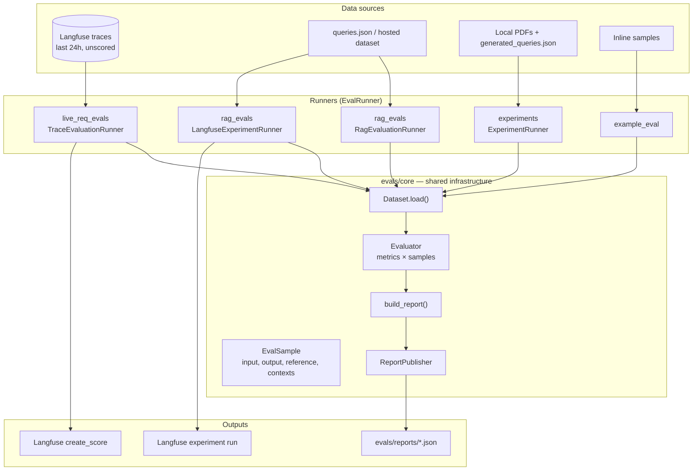

# Evaluation in the Production RAG Platform

This article explains **why** the project measures RAG quality in more than one way, **how** the `evals/` package is structured, and **what** each runner is for. It complements [§11 of the architecture article](ARTICLE.md#11-observability-and-the-evaluation-loop), which situates evals inside the observability story. Operational commands and env vars also live in [`evals/README.md`](../evals/README.md).

Code references point at `evals/` unless noted otherwise.

---

## 1. The problem evals solve

Production RAG fails in different ways at different layers. Retrieval can miss the right chunk while generation still sounds plausible. A guardrail can refuse honestly while your dashboard shows “success.” A prompt change can improve conciseness and hurt faithfulness. Without measurement, every change is judged from five hand-picked examples.

This codebase treats evaluation as **infrastructure**, not a one-off script:

- **Production traffic** (`live_req_evals`) — score real Langfuse traces so you notice drift in what users actually ask.
- **Golden retrieval** (`rag_evals`) — score a fixed dataset against the same `/api/v1/rerank-search` path the stack uses in production, decomposing retrieval vs generation with [Ragas](https://docs.ragas.io/).
- **Isolated experiments** (`evals/experiments`) — ingest a small PDF corpus into a dedicated OpenSearch partition, auto-generate questions, and compare retrieval configs without touching production data.
- **Teaching hook** (`example_eval`) — same core loop with no API keys.

All paths share one **metric execution loop**, one **normalized sample shape**, and one **versioned JSON report schema**. That keeps CI, notebooks, and Langfuse experiments comparable.

Eval-specific dependencies (Ragas, extra judge clients) install via the root `evals` dependency group in `pyproject.toml`. They are **not** required in the production API container image.

---

## 2. Architecture in one picture



**Design rule:** `Evaluator` never knows about Langfuse, Ragas, or file paths. Runners wire datasets, metrics, integrations (`MetricResultHandler`), and reporting.

---

## 3. Shared core

### 3.1 Normalized samples (`EvalSample`)

Every dataset adapter maps its native format into one Pydantic model:

```8:46:evals/core/schemas.py
class EvalSample(BaseModel):
    """One normalized example produced by any evaluation dataset."""

    input: str | None = Field(default=None, validation_alias=AliasChoices("input", "user_input"))
    output: str | None = Field(default=None, validation_alias=AliasChoices("output", "response"))
    reference: str | None = None
    contexts: list[str] = Field(
        default_factory=list,
        validation_alias=AliasChoices("contexts", "retrieved_contexts"),
    )
    source_id: str | None = None
    metadata: dict[str, Any] = Field(default_factory=dict)
```

Alias fields let JSON datasets use `user_input` / `response` while metrics always read `.input`, `.output`, and `.contexts`. Trace-backed samples set `source_id` to the Langfuse trace ID so scores can be pushed back.

### 3.2 Metrics (`Metric`)

Metrics declare **required fields** and implement `_score`. The public `score()` method validates prerequisites and returns a `MetricResult` with `value`, `reasoning`, or `error`:

```26:46:evals/core/metrics.py
class Metric(ABC):
    """Object-oriented contract implemented by every evaluation metric."""

    name: str
    description: str
    required_fields: frozenset[SampleField]

    async def score(self, sample: EvalSample) -> MetricResult:
        """Validate required fields and score one normalized sample."""
        missing = [
            required_field for required_field in self.required_fields if getattr(sample, required_field.value) in (None, "", [])
        ]
        if missing:
            ...
        return await self._score(sample)
```

Two built-in patterns:

| Pattern | Class | Used by |
|--------|--------|---------|
| LLM judge from markdown prompt | `PromptMetric` | `live_req_evals` |
| Callable / Ragas wrapper | `MetricDefinition` or custom `Metric` subclasses | `example_eval`, `rag_evals` |

`PromptMetric` uses structured output (`ScoreSchema`: 0–1 score + one-sentence reasoning) with retries and backoff.

### 3.3 The evaluator loop

```53:115:evals/core/evaluator.py
class Evaluator:
    """Apply any collection of metrics to samples from any dataset."""
    ...
    async def evaluate(self, dataset: Dataset) -> EvaluationResponse:
        samples = await dataset.load()
        for index, sample in enumerate(tqdm(samples, ...)):
            for metric in self.metrics:
                result = await metric.score(sample)
                for handler in self.result_handlers:
                    await handler.handle(sample, result)
            ...
        return EvaluationResponse(...)
```

Optional `MetricResultHandler` hooks run **per metric result** — for example `LangfuseScorePublisher` calls `create_score` on the trace while evaluation is still in progress.

`item_delay_seconds` throttles judge calls (default from `EVALUATION_SLEEP_TIME` in trace evals).

### 3.4 Reports

`build_report()` aggregates `EvaluationResponse` into `EvaluationReport` (`schema_version` `1.0`):

- Per-metric success/failure counts and average scores
- Redacted item previews (200-character caps on input/output/reference)
- Runner-specific metadata (retrieval knobs, ingestion partition, etc.)

`FileReportPublisher` writes:

`evals/reports/evaluation_report_<run_type>_<timestamp>.json`

Run types include `trace_evaluation`, `rag_evaluation`, `experiment_evaluation`, and `example_evaluation`. Pass `--no-report` or `make_report_publisher(enabled=False)` to skip disk output.

### 3.5 Runner contract

```7:12:evals/core/runner.py
class EvalRunner(ABC):
    @abstractmethod
    async def run_eval(self) -> dict[str, Any]:
        """Execute an evaluation and return its serialized report."""
```

Each package exposes a `main.py` CLI that constructs its runner and calls `asyncio.run(runner.run_eval())`.

---

## 4. Production trace scoring (`live_req_evals`)

**Question answered:** “Did live traffic get worse?”

### 4.1 Dataset

`LangfuseTraceDataset`:

1. Lists traces from the last **24 hours** (configurable), oldest first, up to **100** traces.
2. Skips traces that already have **any** score attached.
3. Extracts query and answer via `get_input_output()` — supports RAG API dicts (`query` / `answer`) and LangGraph callback layouts (`output.messages`).

See `evals/live_req_evals/helpers.py` for the full extraction matrix.

### 4.2 Metrics

Prompts live as **markdown files** in `evals/live_req_evals/metrics/prompts/`. `build_metrics()` loads every `*.md` in sorted order — add `safety.md` and you get a `safety` metric without code changes.

Default metrics: `relevancy`, `helpfulness`, `conciseness`, `hallucination`, `toxicity`.

Each metric judges **input + generation only** (no retrieved contexts in the prompt unless you extend the prompt text). That matches the trace payload, which often omits chunk text at the top level. For retrieval-aware judging, use `rag_evals` or enrich traces in the API.

### 4.3 Langfuse write-back

`LangfuseScorePublisher` publishes numeric scores onto the original trace:

```33:42:evals/live_req_evals/runner.py
    async def handle(self, sample: EvalSample, result: MetricResult) -> None:
        if sample.source_id is None or result.value is None or result.error:
            return
        self.langfuse.create_score(
            trace_id=sample.source_id,
            name=result.name,
            data_type="NUMERIC",
            value=result.value,
            comment=result.reasoning,
        )
```

Human feedback via `POST /api/v1/feedback` lands on the same trace objects, so you can eventually compare judge vs user.

### 4.4 Commands

```bash
make eval-quick      # uv run python -m evals.live_req_evals.main --quick
make eval            # interactive confirmation
make eval-no-report
```

Requires Langfuse keys aligned with the running API and an OpenAI-compatible judge (`EVALUATION_LLM`, `EVALUATION_API_KEY` or `OPENAI_API_KEY`).

---

## 5. Golden-set RAG scoring (`rag_evals`)

**Question answered:** “Did chunking, boosts, contextual retrieval, or reranking change retrieval quality?”

### 5.1 Pipeline per query

1. Load `user_input` + `reference` (+ optional `response`) from JSON.
2. `RerankSearchClient` calls **`POST /api/v1/rerank-search`** with the same hybrid + rerank flags as production (`RAG_EVAL_*` settings).
3. Contexts are **`chunk_text`** from the post-rerank list (not contextualized embedding text — generation sees what the agent sees).
4. If `response` is missing and `RAG_EVAL_GENERATE_RESPONSES=true`, the harness generates an answer with the same grounding instruction as production RAG: excerpts only, admit ignorance when unsupported.
5. Six Ragas metrics run through thin `Metric` wrappers in `evals/rag_evals/metrics.py`.

### 5.2 Metric decomposition

| Metric | Needs reference | What it isolates |
|--------|-----------------|------------------|
| `context_relevance` | No | Are chunks about the question? |
| `context_utilization` | No | Ranking quality vs generated answer |
| `faithfulness` | No | Is the answer supported by chunks? |
| `context_precision` | Yes | Relevant chunks ranked high vs reference |
| `context_recall` | Yes | Reference covered by chunks |
| `factual_correctness` | Yes | Answer claims vs reference |

Low `context_recall` with high `faithfulness` usually means **retrieval miss, honest generation**. High faithfulness with zero `factual_correctness` often means **grounded but wrong paper** — a pattern the seed dataset in `evals/rag_evals/queries.json` is designed to surface.

Re-run after any retrieval or index-time change. Treat absolute scores as directional; the seed set is a **regression harness**, not a leaderboard.

### 5.3 Commands

```bash
make rag-eval
make rag-eval-no-report
uv run python -m evals.rag_evals.main --quick
```

Requires the API stack up, indexed corpus, and judge API key.

---

## 6. Langfuse experiments (`rag_evals --langfuse-experiment`)

**Question answered:** “Can I compare two retrieval configs side-by-side in Langfuse?”

The experiment runner reuses the same retrieval + Ragas scoring but orchestrates through the [Langfuse experiments SDK](https://langfuse.com/docs/evaluation/experiments/experiments-via-sdk):

- **Local dataset:** items from `RAG_EVAL_DATASET_PATH` (`input` = query, `expected_output` = reference).
- **Hosted dataset:** set `RAG_EVAL_LANGFUSE_DATASET` to a Langfuse dataset name.

Each item becomes a traced task; Ragas scores attach to the experiment run for UI comparison. The runner still adapts results into `EvaluationResponse` and can emit the unified local JSON report unless `--no-report`.

```bash
make rag-eval-experiment
uv run python -m evals.rag_evals.main --langfuse-experiment --quick
```

Configure `RAG_EVAL_EXPERIMENT_NAME`, `RAG_EVAL_MAX_CONCURRENCY`, etc. (see `evals/README.md`).

---

## 7. Local-PDF experiment (`evals/experiments`)

**Question answered:** “Can I tune retrieval on a tiny corpus without the HTTP API or production index?”

This runner is **self-contained**:

1. **Ingestion partition** — default `evals-experiments`, set via `OPENSEARCH__INGESTION_NAME` so experiment chunks never mix with dev/production partitions.
2. **Conditional ingest** — if OpenSearch already has chunks for that partition, skip; else run `src.ingest.run_pipeline` from local PDFs in `evals/experiments/data/arxiv_pdfs/` (metadata fetched from arXiv by filename stem).
3. **Question generation** — LLM writes Q/A pairs from indexed chunks; cached to `evals/experiments/data/generated_queries.json`.
4. **In-process retrieval** — `make_rerank_search_service()` in `src/domain/search/factory.py` (no HTTP).
5. **Same Ragas metrics** as `rag_evals`.

Settings merge from `evals/experiments/data/settings/experiment-config.json` (chunking, parser, query knobs) with env overrides. Use alternate JSON via `--settings` or `make experiment-eval EXPERIMENT_SETTINGS=...`.

```bash
make experiment-eval         # reuse cache when possible
make experiment-eval-fresh   # --force-ingest --regenerate-queries
```

**Caveat:** the same judge model generates questions and answers, so absolute scores skew high. Use this path to **compare configurations across runs**, not as an absolute quality bar.

---

## 8. Minimal example (`example_eval`)

```bash
uv run python -m evals.example_eval.main
```

Demonstrates:

- Inline `Dataset` with three `EvalSample`s
- Deterministic `exact_match` metric via `MetricDefinition`
- Full `Evaluator` → `build_report` → optional file publish

No Langfuse, Ragas, or network. Useful when extending the core or teaching the report schema.

---

## 9. How evals connect to the rest of the system

### 9.1 Trajectory and structural assertions

Agentic responses include a **trajectory** (`steps`, `events`, `summary`) — see [§7.2 in ARTICLE.md](ARTICLE.md). Langfuse traces capture spans; trajectory captures **graph shape** in the HTTP payload.

Use trajectory for cheap structural tests (`tool:retrieve_papers` present, retrieve count ≤ 2). Use `live_req_evals` for semantic quality on production text. Use `rag_evals` when you change anything upstream of generation.

Confidence-aware fields (`response_status`, `retrieval_confidence`, `abstention_reason`) support fixtures that assert **refusal behaviour**, not just answer prose — see [§11.3 in ARTICLE.md](ARTICLE.md).

### 9.2 Quality ladder

[§14 of ARTICLE.md](ARTICLE.md#14-the-quality-ladder-every-lever-and-what-it-costs) lists index-time and query-time levers in pipeline order. **`rag_evals` is the feedback loop for that table’s retrieval rows** — especially `context_recall` before enabling expensive index-time contextual retrieval.

### 9.3 What is still missing

Scores are computed and stored, but **nothing fails CI or blocks deploy** on regression yet. The architecture article calls that out explicitly. Wiring `make rag-eval` (or a subset) into CI with thresholds on `metrics_summary` is the natural next step.

---

## 10. Extending the framework

### Add a trace metric

1. Create `evals/live_req_evals/metrics/prompts/my_metric.md`.
2. Re-run `live_req_evals` — discovery is automatic.

### Add a Ragas or custom metric

1. Implement `Metric` with the right `required_fields`.
2. Register in `rag_evals/metrics.py` `build_metrics()` (or pass a custom list into the runner in tests).

### Add a new runner

1. Implement `Dataset.load()` → `list[EvalSample]`.
2. Subclass or compose `EvalRunner`: configure `Evaluator`, call `build_report()`, publish.
3. Add `python -m evals.my_runner.main` and a Makefile target.

Keep business logic out of `Evaluator` — only orchestration belongs there.

### Inject dependencies in tests

Runners accept optional `dataset`, `metrics`, and `report_publisher`. Tests under `tests/evals/` use fakes and fixtures without calling live APIs. Run:

```bash
uv run pytest tests/evals/ -q
```

---

## 11. Configuration quick reference

| Concern | Primary env vars / files |
|--------|---------------------------|
| Judge LLM | `EVALUATION_LLM`, `EVALUATION_API_KEY`, `EVALUATION_BASE_URL`, `EVALUATION_SLEEP_TIME` |
| Langfuse | `LANGFUSE_PUBLIC_KEY`, `LANGFUSE_SECRET_KEY`, `LANGFUSE_HOST` |
| RAG API eval | `RAG_API_BASE_URL`, `RAG_EVAL_DATASET_PATH`, `RAG_EVAL_TOP_K`, `RAG_EVAL_USE_HYBRID`, `RAG_EVAL_RERANK_ENABLED` |
| Experiments | `experiment-config.json`, `EXPERIMENT_INGESTION_NAME`, `EXPERIMENT_PDFS_DIR`, … |

Full tables: [`evals/README.md`](../evals/README.md) and `.env.example`.

---

## 12. Mental model

- **Traces** tell you *what happened*; **evals** tell you *whether it was good*.
- **Two loops** because imagined queries (`queries.json`) and real queries (Langfuse) diverge — you need both.
- **One core** so a new integration (CI gate, notebook, experiment UI) does not fork the metric loop again.
- **Reports with schema version** so you can diff runs in git or a dashboard without parsing ad hoc logs.

For retrieval mechanics that evals depend on, see [How OpenSearch Powers Retrieval](opensearch-search.md). For running the stack and Makefile targets, see [onboarding](onboarding.md).
