# Dual-level knowledge graph: LightRAG-style retrieval on arXiv chunks

This article explains the optional **knowledge graph (KG)** path in the arXiv research assistant. It covers **why** the design exists, **what** gets stored where, and **how** indexing and query-time retrieval work in code under `src/domain/kg/`. Hybrid chunk search (BM25 + kNN + RRF) is documented separately in [opensearch-search.md](opensearch-search.md).

The KG path is **off by default** (`KG__ENABLED=false`). When enabled, it adds a second retrieval mode that does **not** embed the raw user query against chunk vectors. Instead it follows a **dual-level** pattern inspired by [LightRAG](https://arxiv.org/abs/2410.05729): extract themes and entities from the query, search **entity** and **relation** vector stores, hydrate a **table graph** in PostgreSQL, then load **evidence chunks** from the existing hybrid index via provenance keys.

An optional **PathRAG** layer (see **§6.8**) runs on top of the same graph and adds multi-hop path narration between entity seeds when `KG__PATH_RETRIEVAL_ENABLED=true`. Indexing is unchanged; only query-time context grows.

---

## 1. Problem the KG path tries to solve

Flat chunk retrieval is excellent when the answer lives in a single passage and lexical or semantic overlap between query and chunk is strong. It struggles when:

- The user asks about a **concept or relationship** that is spread across many chunks ("how does method A relate to benchmark B across these papers?").
- The query is ** thematic** rather than a copy of a sentence in the corpus.
- You want retrieval context that includes **structured summaries** (entities and edges) in addition to raw text.

The KG layer builds a lightweight graph at index time—entities and directed relations extracted from each chunk—and retrieves through two parallel vector channels at query time (local/entity vs global/relation keywords). Chunk text remains the grounding evidence; the graph is a routing and summarization layer, not a replacement for citations.

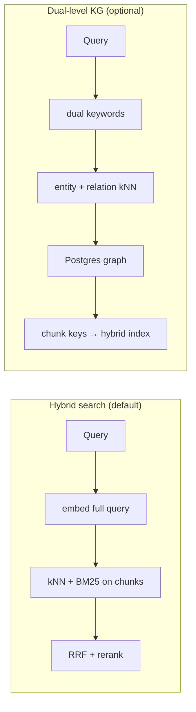

---

## 2. Architecture in one picture

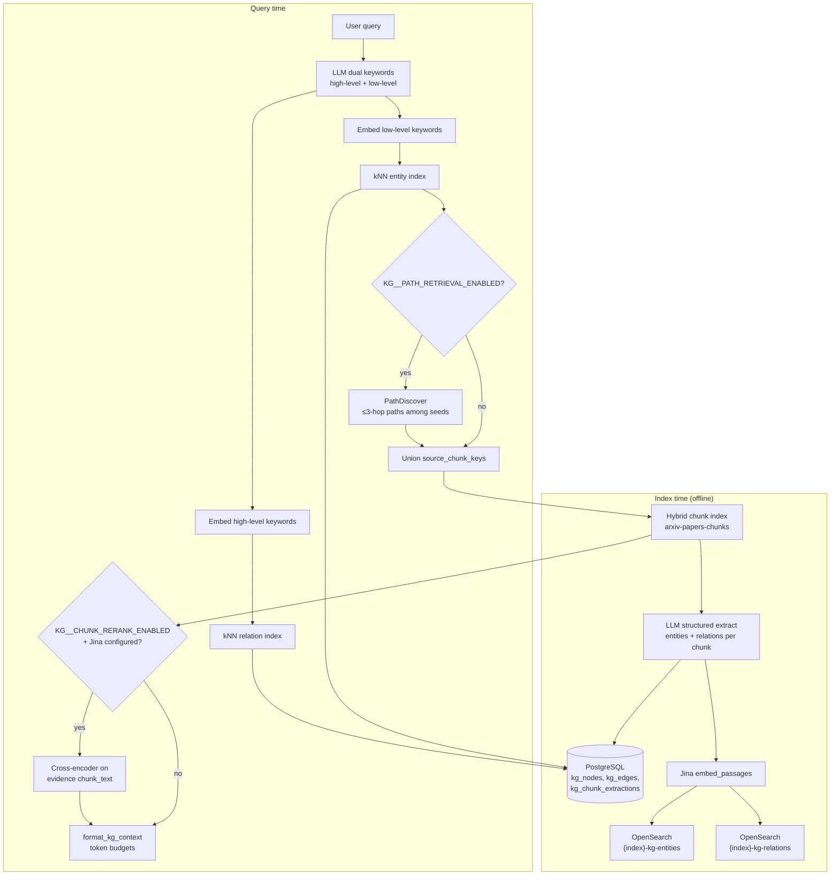

**Design choices worth stating up front:**

| Choice | Rationale |
|--------|-----------|
| **Table graph in Postgres**, not Apache AGE / Neo4j | Same operational stack as paper metadata; upserts and provenance lists are enough for this use case. |
| **Separate OpenSearch indices** for entity/relation vectors | Chunk embeddings stay in the hybrid index; KG vectors can be rebuilt without touching chunk mappings. |
| **`ingestion_name` partition** on every row and vector doc | Aligns with `OPENSEARCH__INGESTION_NAME` so dev/eval corpora do not leak into each other. |
| **No chunk kNN on the raw query** in the KG path | Retrieval is keyword-guided into the graph, then chunk lookup by key—different failure mode than hybrid search, useful for experiments. |

### 2.1 Storage layout (Postgres + OpenSearch)

Provenance is the glue: every node and edge remembers which hybrid chunks justified it.

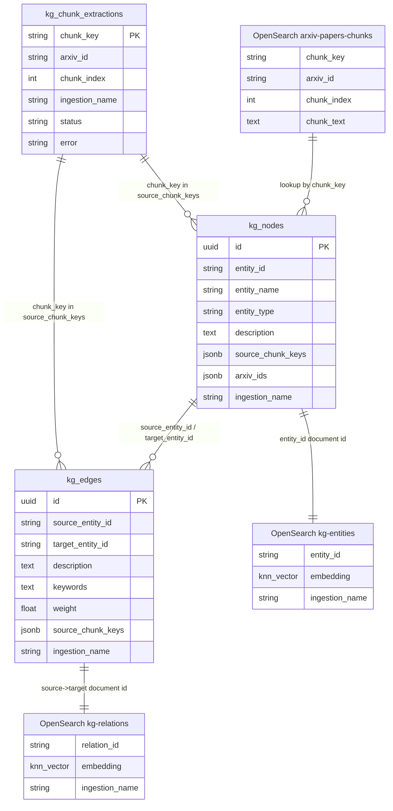

**Example Postgres node** (after two chunks mention the same entity; merged in application code):

```json
{
  "entity_id": "multi_head_attention",
  "entity_name": "Multi-Head Attention",
  "entity_type": "METHOD",
  "description": "Parallel attention heads over query, key, and value projections. Scaled dot-product attention is applied in each head.",
  "source_chunk_keys": ["1706.03762:3", "1706.03762:4"],
  "arxiv_ids": ["1706.03762"],
  "ingestion_name": "local-dev"
}
```

**Example OpenSearch entity document** (`_id`: `multi_head_attention`):

```json
{
  "entity_id": "multi_head_attention",
  "entity_name": "Multi-Head Attention",
  "entity_type": "METHOD",
  "description": "Parallel attention heads over query, key, and value projections...",
  "ingestion_name": "local-dev",
  "embedding": [0.012, -0.034, "... 1024 floats ..."]
}
```

Relation documents use `_id` `scaled_dot_product_attention->multi_head_attention` and embed text shaped like `source -> target`, description, and keywords (see §4.1).

---

## 3. Persistence model

### 3.1 PostgreSQL (`src/domain/kg/models.py`)

Three tables, all scoped by `ingestion_name`:

| Table | Role |
|-------|------|
| `kg_nodes` | Merged **entities**: `entity_id` (slug), display name, type, merged description, `source_chunk_keys[]`, `arxiv_ids[]`. |
| `kg_edges` | **Directed relations** between `entity_id` values: description, thematic `keywords`, `weight`, `source_chunk_keys[]`. |
| `kg_chunk_extractions` | **Idempotency**: one row per `{arxiv_id}:{chunk_index}` with status `done` / `failed` so CLI runs skip completed chunks. |

Entity IDs are stable slugs from display names (`normalize_entity_id` in `src/domain/kg/merge.py`)—lowercase, punctuation stripped, whitespace collapsed—similar in spirit to LightRAG entity keys.

Chunk provenance uses keys `"{arxiv_id}:{chunk_index}"` (`make_chunk_key`), matching how chunks are addressed in OpenSearch.

### 3.2 OpenSearch vector indices (`src/domain/kg/kg_search_client.py`)

Index names: `{OPENSEARCH__INDEX_NAME}-{KG__ENTITY_INDEX_SUFFIX}` and `...-{KG__RELATION_INDEX_SUFFIX}` (defaults `kg-entities`, `kg-relations`).

Each document includes:

- `ingestion_name` (keyword filter on every kNN query)
- `embedding` (1024-d HNSW, cosine—same dimension as Jina v3 passage embeddings)
- Metadata fields for debugging (`entity_name`, `description`, or relation endpoints and keywords)

Document IDs: `entity_id` for nodes; `source_entity_id->target_entity_id` for edges (`relation_vector_id`).

Mappings live in `src/domain/kg/index_config.py` with `dynamic: strict` so accidental fields fail fast at index time.

---

## 4. Index-time pipeline

Entry point: `KgIndexingService.index_arxiv_ids()` in `src/domain/kg/indexing_service.py`.

**Prerequisite:** hybrid chunks for each `arxiv_id` must already exist (`HybridRrfSearch.get_chunks_by_paper`). The KG job does not parse PDFs or chunk text.

### 4.1 Per-chunk flow (sequence)

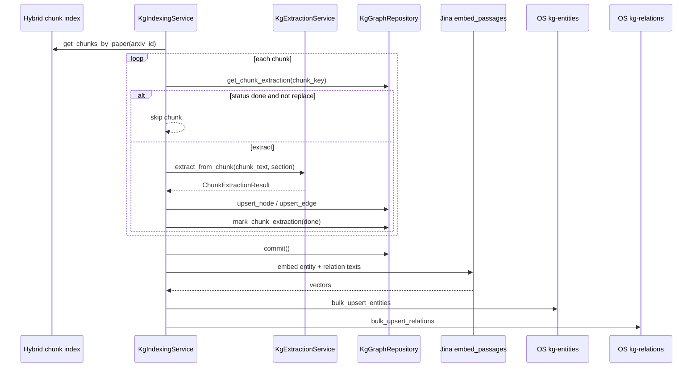

Steps in code:

1. **`setup_indices()`** — create entity/relation indices if missing.
2. For each chunk (in OpenSearch order):
   - Skip if `kg_chunk_extractions.status == done` and `replace=False`.
   - **LLM extract** — `KgExtractionService.extract_from_chunk()` with structured output `ChunkExtractionResult` (Pydantic), capped by `KG__MAX_ENTITIES_PER_CHUNK` / `KG__MAX_RELATIONS_PER_CHUNK`. Concurrency limited by `KG__MAX_CONCURRENT_EXTRACTIONS` (semaphore).
   - **Upsert graph** — `KgGraphRepository.upsert_node` / `upsert_edge`; merge logic appends unique description sentences and chunk keys without a second LLM summarize pass.
   - **Track vector docs** — dedupe within the paper in `_PendingVectorIndex`.
   - Mark chunk `done` or `failed` (with error text).
3. After all chunks for the paper commit to Postgres, **embed and bulk-upsert** vectors:
   - Entity text: `"{entity_name}\n{description}"`
   - Relation text: `"{source} -> {target}\n{description}\n{keywords}"`
   - Jina `embed_passages`, batch size 32.

### 4.2 Example: LLM extraction output (one chunk)

Structured output schema: `ChunkExtractionResult` in `src/domain/kg/schemas.py`. Typical model response for a methods paragraph:

```json
{
  "entities": [
    {
      "entity_name": "Transformer",
      "entity_type": "MODEL",
      "description": "Encoder-decoder architecture relying entirely on attention, without recurrence or convolutions."
    },
    {
      "entity_name": "BLEU",
      "entity_type": "METRIC",
      "description": "Machine translation evaluation metric used on WMT 2014 English-German."
    }
  ],
  "relations": [
    {
      "source_entity": "Transformer",
      "target_entity": "BLEU",
      "description": "The Transformer achieves state-of-the-art BLEU on English-German translation.",
      "keywords": "machine translation, benchmark",
      "weight": 1.0
    }
  ]
}
```

After upsert, `Transformer` becomes `entity_id` `transformer`; relation vector id `transformer->bleu`.

### 4.3 Idempotency state (per chunk)

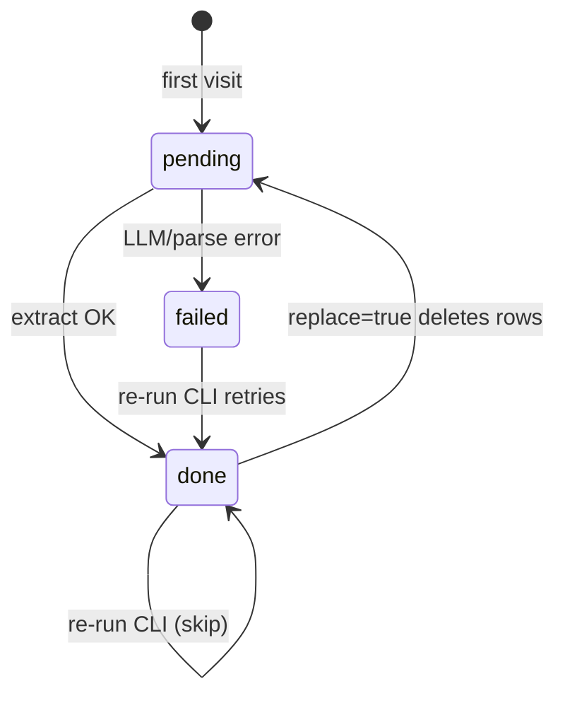

### 4.4 Relation endpoint resolution

Relations reference entities by **name** from the LLM. Within a chunk, a `name_to_id` map ties extracted entities to IDs. Endpoints mentioned only on an edge get placeholder nodes (`entity_type=UNKNOWN`) via `_ensure_relation_endpoint_nodes`. Self-loops are dropped.

### 4.5 Replace / partial delete

`replace=True` (CLI `--replace`, eval `force=True`) calls `delete_graph_for_arxiv`: strip chunk keys from nodes/edges, delete orphaned edges/nodes, remove extraction rows. Vector indices for that paper are updated on the next successful embed pass for the remaining unique entity/relation docs in that run (full vector GC across papers is not implemented—see limitations).

### 4.6 How to run indexing

```bash
# .env: KG__ENABLED=true, hybrid index populated for the papers
make kg-index ARXIV_IDS=2611.02200,2611.02208
make kg-index ARXIV_IDS=2611.02200 REPLACE=1   # re-extract
```

**Example CLI return value** (`index_arxiv_ids` stats dict):

```json
{
  "papers": 2,
  "chunks_processed": 47,
  "chunks_skipped": 3,
  "chunks_failed": 1,
  "entities_upserted": 312,
  "relations_upserted": 89
}
```

`entities_upserted` counts upsert calls (including repeats across chunks), not unique nodes. Use Postgres/`kg_chunk_extractions` for operational health.

Eval experiments call the same service via `KgGraphIngestor` in `evals/experiments/ingestion.py` after hybrid ingest when KG is enabled.

---

## 5. Graph merge semantics

`KgGraphRepository` (`src/domain/kg/repository.py`) implements **deterministic merge** at upsert time:

- **Descriptions:** `merge_descriptions` appends new sentences not already present, capped at 8000 characters.
- **Chunk keys and arxiv IDs:** `merge_unique_strings` preserves order while deduplicating.
- **Edge keywords:** concatenated when new keywords appear.
- **Edge weight:** `max(existing, new)`.

This avoids an extra "summarize the neighborhood" LLM call at index time (cheaper, but descriptions can grow verbose until truncation at format time).

At query time, **entity rank** exposed to the formatter is **graph degree**: count of incident edges where the entity is source or target (`node_counts`). **Relation rank** uses stored `weight` (integer cast for sorting).

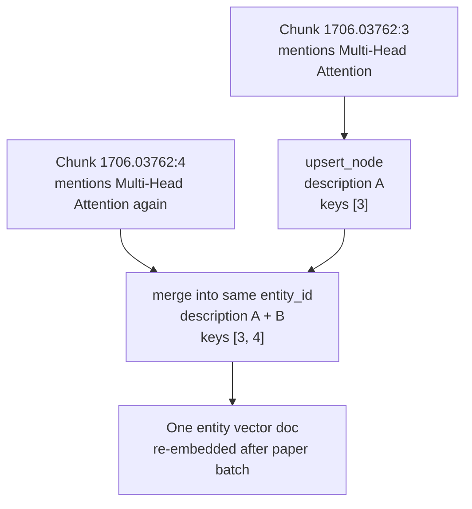

---

## 6. Query-time dual-level retrieval

Implemented in `DualLevelKGRetrievalService.retrieve()` (`src/domain/kg/dual_level_retrieval.py`).

### 6.1 End-to-end sequence

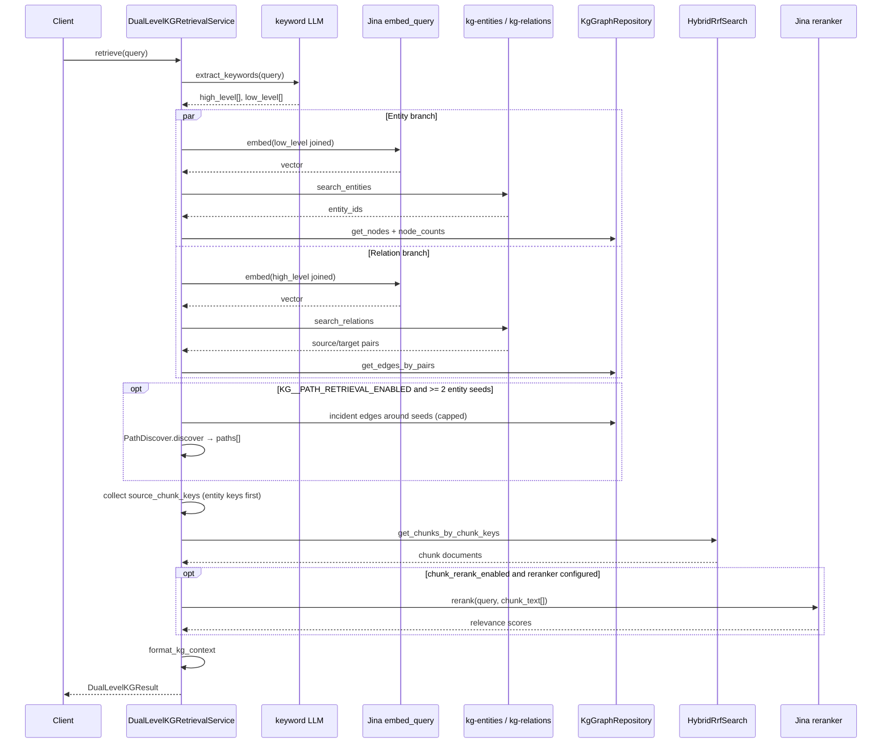

### 6.2 Step 1 — Dual keywords

`KgExtractionService.extract_keywords()` returns `DualKeywords`:

- **High-level:** themes, abstract topics → relation path.
- **Low-level:** specific names, methods, numbers → entity path.

Models are configurable separately: `KG__EXTRACT_MODEL` (index-time extract) vs `KG__KEYWORD_MODEL` (query keywords); both default to `AGENT_MODEL`.

**Example keyword split** for the query *"How does scaled dot-product attention relate to training efficiency in the Transformer?"*:

```json
{
  "high_level_keywords": [
    "attention mechanism",
    "training efficiency",
    "neural architecture"
  ],
  "low_level_keywords": [
    "scaled dot-product attention",
    "Transformer",
    "multi-head attention"
  ]
}
```

**Fallback when the LLM returns empty keywords:**

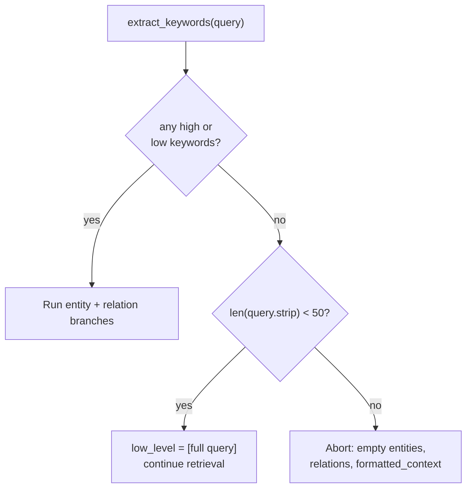

### 6.3 Step 2 — Entity branch (low-level)

1. Embed `", ".join(low_level_keywords)` with `embed_query`.
2. kNN on entity index (`top_k_entities`, default `KG__TOP_K_ENTITIES`).
3. Load `KgNode` rows from Postgres; compute degree ranks.
4. Register each node's `source_chunk_keys` on a `_ChunkKeyCollector` (entity keys ordered before relation keys).

### 6.4 Step 3 — Relation branch (high-level)

1. Embed high-level keywords.
2. kNN on relation index (`top_k_relations`).
3. Load matching `KgEdge` rows by `(source_entity_id, target_entity_id)` pairs.
4. Register edge `source_chunk_keys`.

### 6.5 Step 4 — Evidence chunks

Sorted chunk keys are resolved through **`HybridRrfSearch.get_chunks_by_chunk_keys`** (`src/domain/rrf/search.py`)—the same hybrid index used for normal search—producing `KgChunkHit` records with title, authors, section, and `chunk_text`.

Entity and relation hits are sorted by graph **rank** (degree for entities, edge weight for relations). Chunk order starts as **discovery order**: keys collected from entity paths first, then relation paths (`_ChunkKeyCollector`).

### 6.6 Step 5 — Evidence chunk rerank (optional, on by default)

After chunks are loaded, `_rerank_chunk_hits()` may reorder them before the token budget is applied:

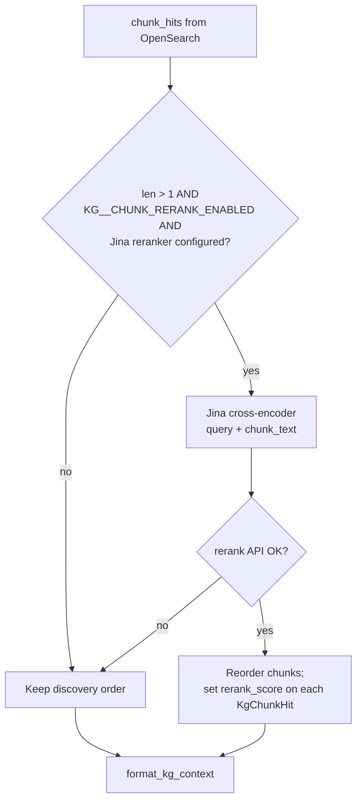

- Wired in `make_dual_level_kg_retrieval_service()` via `make_reranker_client()` (same Jina stack as hybrid `SearchService`).
- Model: `KG__CHUNK_RERANK_MODEL` (default `jina-reranker-v2-base-multilingual`).
- Uses the **full user query**, not the dual keyword strings—same semantics as hybrid reranking, but only over the smaller provenance set from the graph.
- On failure, logs a warning and **keeps discovery order** (no request error).

This is not BM25 and not RRF; it is the same cross-encoder precision stage used elsewhere, applied after graph routing.

### 6.7 Step 6 — Context formatting

`format_kg_context()` (`src/domain/kg/context_format.py`) builds LLM-ready text:

1. CSV-like **Entities** block (id, name, type, description, rank).
2. CSV-like **Relations** block (endpoints, description, keywords, weight, rank).
3. When PathRAG is enabled and paths were found: **`--- Relations (KG paths) ---`** with CSV-like rows (`hop_count`, narrated multi-hop text).
4. **Evidence chunks** with headers `[arxiv_id chunk N] title — section`.

Token limits use a rough `len/4` estimator:

- `KG__MAX_ENTITY_TOKENS`, `KG__MAX_RELATION_TOKENS` truncate the first two blocks.
- `KG__MAX_PATH_TOKENS` applies to the path block (when present).
- Remaining budget under `KG__MAX_TOTAL_TOKENS` fills chunks in order until exhausted.

Output is returned as `DualLevelKGResult.formatted_context` alongside structured hits for debugging and evals.

### 6.8 PathRAG multi-hop path retrieval

#### What PathRAG adds

[LightRAG-style dual-level retrieval](#6-query-time-dual-level-retrieval) already loads **individual** entity rows and **relation kNN hits**. **PathRAG** (from [BUPT-GAMMA/PathRAG](https://github.com/BUPT-GAMMA/PathRAG/tree/main/PathRAG), `operate._find_most_related_edges_from_entities3`) answers a different question:

> *Given the entity seeds from low-level keyword search, what **connected paths** (1–3 hops) exist between them in the table graph, and how should those paths be narrated for the LLM?*

Paths are **derived at query time** from existing `kg_nodes` / `kg_edges`. There is no extra index or storage backend.

| | Dual-level only | + PathRAG (`KG__PATH_RETRIEVAL_ENABLED`) |
|--|-----------------|------------------------------------------|
| Relation signal | Relation **vector** kNN (high-level keywords) | **Plus** multi-hop **paths among entity seeds** |
| Typical question shape | Thematic / global themes | Multi-hop links between named concepts |
| `DualLevelKGResult` | `entities`, `relations`, `chunks` | Adds `paths[]` with narratives |
| `formatted_context` | Entities + relations CSV | Adds `--- Relations (KG paths) ---` |

PathRAG does **not** replace the relation kNN branch; it **augments** the entity (local) branch, matching the reference implementation’s local path step.

#### Code layout

| Piece | Location |
|-------|----------|
| Path algorithm + narration | `PathDiscover` in `src/domain/kg/path_retrieval.py` |
| Factory | `make_path_discover(settings)` in `src/domain/kg/factory.py` |
| Orchestration | `DualLevelKGRetrievalService` loads a bounded subgraph, calls `path_discover.discover()` |
| Subgraph load | `KgGraphRepository.get_incident_edges_for_entity_ids` |
| Schema | `KgPathHit`, `DualLevelKGResult.paths` in `src/domain/kg/schemas.py` |

`make_dual_level_kg_retrieval_service()` wires a `PathDiscover` built from `KGSettings` path knobs. Tests may inject a custom `PathDiscover` into `DualLevelKGRetrievalService(..., path_discover=...)` without changing env.

#### Pipeline (inside `PathDiscover.discover`)

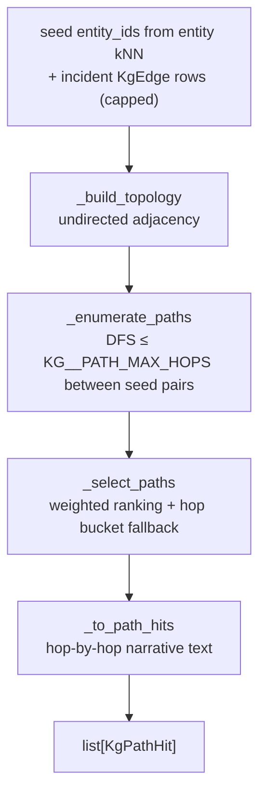

1. **Subgraph:** After entity hits (only when `KG__PATH_RETRIEVAL_ENABLED`), the service loads up to `KG__PATH_SUBGRAPH_MAX_EDGES` edges incident on seed nodes (Postgres, ordered by `weight` desc), then trims that list so the distinct endpoints do not exceed `KG__PATH_SUBGRAPH_MAX_NODES`.
2. **Enumerate:** For each ordered pair of distinct seeds, DFS finds simple paths up to `KG__PATH_MAX_HOPS` edges.
3. **Rank:** PathRAG **edge-flow weighting** (`KG__PATH_WEIGHT_THRESHOLD`, `KG__PATH_WEIGHT_ALPHA`) scores candidate paths; dedupe and cap at `KG__PATH_MAX_PATHS`. If weighting yields nothing, a hop-bucket fallback uses a slice of 1-/2-/3-hop paths (reference behavior).
4. **Narrate:** Each selected path becomes prose: entity type/description plus `through edge (keywords)` between hops, using stable `entity_id` slugs and merged node text from Postgres.
5. **Format:** `format_kg_context` includes the path block under `KG__MAX_PATH_TOKENS`; token budget for chunks is computed after entities, flat relations, and paths.

When path retrieval is off (default), `_discover_paths` returns before any incident-edge query; `paths` stays `[]` and plain `kg` mode avoids extra Postgres work.

#### Example `paths` entry (debug JSON)

```json
{
  "entity_ids": ["transformer", "multi_head_attention", "scaled_dot_product_attention"],
  "hop_count": 2,
  "weight": 0.0,
  "narrative": "The entity Transformer is a MODEL with the description (...) through edge (architecture, component) to connect to Transformer and Multi-Head Attention and The entity Multi-Head Attention is a METHOD with the description (...)"
}
```

Inspect via `POST /api/v1/kg-retrieval/debug` with both `KG__ENABLED=true` and `KG__PATH_RETRIEVAL_ENABLED=true`.

#### Evaluations

Experiment settings support `retrieval_mode`:

| Mode | Retrieval | PathRAG |
|------|-----------|---------|
| `rrf` | Hybrid chunk search | — |
| `kg` | `dual_search` (dual-level) | off (`paths` empty unless you enable paths globally) |
| `pathrag` | Same as `kg` | requires `KG__PATH_RETRIEVAL_ENABLED=true`; metadata includes `path_count` |

Set `KG__INGESTION_NAME` (or rely on `OPENSEARCH__INGESTION_NAME`) for the experiment partition the same as for `kg` mode.

#### Operational notes

- Requires **at least two** entity seeds that share a connected subgraph within hop and edge caps; otherwise `paths` stays empty without error.
- Large partitions: path search runs on a **bounded** edge set around seeds, not the full corpus graph.
- The agentic fusionsearch graph does **not** consume PathRAG context yet; use debug API, `dual_search`, or evals.

Unit tests: `tests/unit/domain/kg/test_path_retrieval.py` (fixture graphs, disabled discoverer).

---

## 7. Output examples

These examples match the shapes returned by `DualLevelKGRetrievalService` and `POST /api/v1/kg-retrieval/debug`. Field names are stable OpenAPI types from `DualLevelKGResult`.

### 7.1 Debug API request

```bash
curl -s -X POST http://localhost:8000/api/v1/kg-retrieval/debug \
  -H 'Content-Type: application/json' \
  -d '{
    "query": "What is multi-head attention in the Transformer?",
    "top_k_entities": 5,
    "top_k_relations": 5
  }'
```

When `KG__ENABLED=false`, the same call returns **503** with detail explaining that KG is disabled.

### 7.2 Debug API response (structured JSON)

Illustrative payload (scores and text shortened):

```json
{
  "query": "What is multi-head attention in the Transformer?",
  "high_level_keywords": ["attention mechanism", "model architecture"],
  "low_level_keywords": ["multi-head attention", "Transformer", "scaled dot-product"],
  "entities": [
    {
      "entity_id": "multi_head_attention",
      "entity_name": "Multi-Head Attention",
      "entity_type": "METHOD",
      "description": "Runs h parallel attention layers; outputs are concatenated and projected.",
      "rank": 4,
      "source_chunk_keys": ["1706.03762:3", "1706.03762:4"]
    },
    {
      "entity_id": "transformer",
      "entity_name": "Transformer",
      "entity_type": "MODEL",
      "description": "Encoder-decoder stack using attention instead of RNNs.",
      "rank": 12,
      "source_chunk_keys": ["1706.03762:1", "1706.03762:3"]
    }
  ],
  "paths": [
    {
      "entity_ids": ["transformer", "multi_head_attention"],
      "hop_count": 1,
      "weight": 0.0,
      "narrative": "The entity Transformer is a MODEL ... through edge (architecture, component) ..."
    }
  ],
  "relations": [
    {
      "source_entity_id": "multi_head_attention",
      "target_entity_id": "transformer",
      "description": "Multi-head attention is a sub-layer inside each Transformer block.",
      "keywords": "architecture component",
      "weight": 1.0,
      "rank": 1,
      "source_chunk_keys": ["1706.03762:3"]
    }
  ],
  "chunks": [
    {
      "chunk_key": "1706.03762:3",
      "arxiv_id": "1706.03762",
      "chunk_index": 3,
      "chunk_text": "Instead of performing a single attention function with d_model-dimensional keys, values and queries, we found it beneficial to linearly project the queries, keys and values h times with different, learned linear projections to d_k, d_k and d_v dimensions, respectively.",
      "title": "Attention Is All You Need",
      "authors": "Vaswani et al.",
      "section_name": "Model Architecture",
      "rerank_score": 0.94
    }
  ],
  "formatted_context": "... see §7.3 ..."
}
```

`rerank_score` is `null` when chunk reranking is disabled, the reranker is not configured, there is only one chunk, or reranking was skipped.
```

Use the structured arrays for eval assertions (entity ids, chunk keys, keyword lists). Use `formatted_context` when prototyping prompts that might later feed an LLM.

### 7.3 `formatted_context` (LLM-oriented string)

Same retrieval as §7.2, as produced by `format_kg_context` (CSV quoting escapes embedded double quotes in descriptions):

```text
--- Entities (KG) ---
id,entity_name,entity_type,description,rank
1,"Multi-Head Attention","METHOD","Runs h parallel attention layers; outputs are concatenated and projected.",4
2,"Transformer","MODEL","Encoder-decoder stack using attention instead of RNNs.",12

--- Relations (KG) ---
id,source,target,description,keywords,weight,rank
1,"multi_head_attention","transformer","Multi-head attention is a sub-layer inside each Transformer block.","architecture component",1.0,1

--- Evidence chunks ---
[1706.03762 chunk 3] Attention Is All You Need — Model Architecture
Instead of performing a single attention function with d_model-dimensional keys, values and queries, we found it beneficial to linearly project the queries, keys and values h times with different, learned linear projections to d_k, d_k and d_v dimensions, respectively.
```

If the total token budget is exhausted after the entity and relation blocks, trailing evidence chunks are dropped even when `chunks` in JSON lists more keys—check `KG__MAX_*_TOKENS` when debugging "missing" passages.

### 7.4 Keyword abort (empty context)

Long query, keyword LLM returns both lists empty → no embedding calls:

```json
{
  "query": "Can you elaborate on the broader implications for epistemology in modern ML discourse without naming any method?",
  "high_level_keywords": [],
  "low_level_keywords": [],
  "entities": [],
  "relations": [],
  "chunks": [],
  "formatted_context": ""
}
```

### 7.5 Short-query fallback

Query length under 50 characters with empty keyword lists uses the raw query as a single low-level keyword (entity branch only unless high-level keywords appear):

```json
{
  "query": "BLEU",
  "high_level_keywords": [],
  "low_level_keywords": ["BLEU"],
  "entities": [],
  "relations": [],
  "chunks": [],
  "formatted_context": ""
}
```

(empty hits simply means no matching graph or vectors for that corpus slice—not a special error)

---

## 8. Application wiring

### 8.1 Factories (`src/domain/kg/factory.py`)

| Factory | Builds |
|---------|--------|
| `make_kg_indexing_service` | Index pipeline with extract model |
| `make_dual_level_kg_retrieval_service` | Query pipeline with keyword model, `PathDiscover`, optional `JinaRerankerClient` |
| `make_path_discover` | PathRAG path finder from `KGSettings` path fields |
| `make_kg_search_client` | OpenSearch KG indices for resolved `ingestion_name` |

`resolve_kg_ingestion_name()` uses `KG__INGESTION_NAME` when set, otherwise `OPENSEARCH__INGESTION_NAME`.

### 8.2 FastAPI lifespan (`src/main.py`)

When `settings.kg.enabled`:

- `app.state.kg_indexing_service` — available for future HTTP/admin hooks; indexing today is CLI/eval-driven.
- `app.state.kg_retrieval_service` — injected into `SearchService` for `dual_search`.

When disabled, KG factories are not called; tests patch them to `None` in API conftest.

### 8.3 Search API surface

- **`SearchService.dual_search()`** (`src/domain/search/service.py`) delegates to `DualLevelKGRetrievalService.retrieve`. Raises `RuntimeError` if KG was not wired—callers must check `KG__ENABLED`.
- **`POST /api/v1/kg-retrieval/debug`** (`src/api/kg_retrieval.py`) returns the full `DualLevelKGResult` JSON (keywords, entities, relations, optional `paths`, chunks, `formatted_context`) without running the LangGraph agent. Returns **503** when KG is disabled.

### 8.4 Stored graph visualization (read-only)

To **inspect what is already in Postgres** (`kg_nodes`, `kg_edges`), use the export endpoint and the bundled static page:

- **`GET /api/v1/kg/graph`** (`src/api/kg_visualization.py`) — returns a **bounded** subgraph as JSON (`nodes`, `edges`, `ingestion_name`, truncation flags). Query params: optional `ingestion_name` (defaults via `resolve_kg_ingestion_name`), optional `arxiv_id` (keeps only nodes whose `arxiv_ids` array contains that id), `max_nodes` (default 300, cap 500), `max_edges` (default 1000, cap 5000). Does **not** require `KG__ENABLED`; it only reads the table graph.
- **`GET /kg-viz/`** — when the API is running, open [`http://localhost:8000/kg-viz/`](http://localhost:8000/kg-viz/) for a **vis-network** view that calls the export endpoint (set API base if you open the file from another origin). Large corpora: lower `max_nodes` / `max_edges` if the browser feels sluggish.

The **fusionsearch agent** still uses hybrid `search_unified()` via its retriever tool—it does **not** call `dual_search` yet. The KG path is for experiments, eval ingestion, and debug API inspection until product wiring decides how to fuse graph context with graded chunk retrieval.

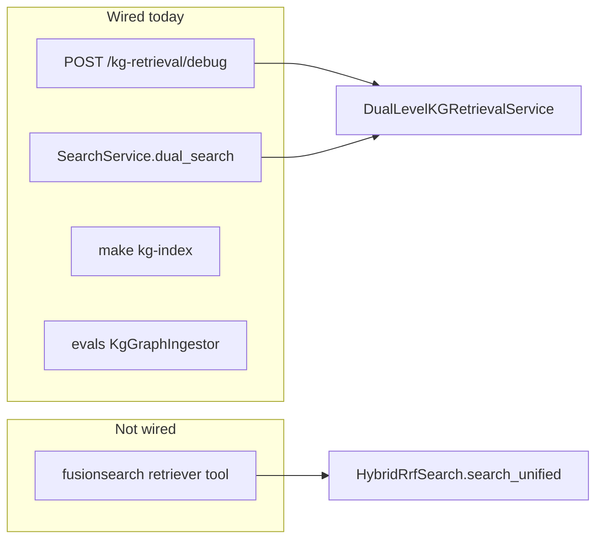

---

## 9. Configuration reference

All settings use the `KG__` prefix (`KGSettings` in `src/config.py`):

| Variable | Default | Meaning |
|----------|---------|---------|
| `KG__ENABLED` | `false` | Master switch for lifespan wiring, CLI, debug route, eval KG ingest |
| `KG__INGESTION_NAME` | `""` | Graph/vector partition; empty → `OPENSEARCH__INGESTION_NAME` |
| `KG__ENTITY_INDEX_SUFFIX` | `kg-entities` | OpenSearch entity index suffix |
| `KG__RELATION_INDEX_SUFFIX` | `kg-relations` | OpenSearch relation index suffix |
| `KG__MAX_CONCURRENT_EXTRACTIONS` | `3` | LLM extract parallelism per indexing run |
| `KG__EXTRACT_MODEL` | `""` | Index-time model; default agent model |
| `KG__KEYWORD_MODEL` | `""` | Query keyword model; default agent model |
| `KG__MAX_ENTITIES_PER_CHUNK` | `20` | Cap structured extract output |
| `KG__MAX_RELATIONS_PER_CHUNK` | `20` | Cap structured extract output |
| `KG__TOP_K_ENTITIES` | `10` | Entity kNN width |
| `KG__TOP_K_RELATIONS` | `10` | Relation kNN width |
| `KG__MAX_ENTITY_TOKENS` | `4000` | Formatter budget for entity block |
| `KG__MAX_RELATION_TOKENS` | `4000` | Formatter budget for relation block |
| `KG__MAX_TOTAL_TOKENS` | `12000` | Total context budget including chunks |
| `KG__CHUNK_RERANK_ENABLED` | `true` | Cross-encoder rerank on graph evidence chunks |
| `KG__CHUNK_RERANK_MODEL` | `jina-reranker-v2-base-multilingual` | Reranker model id passed to Jina |
| `KG__PATH_RETRIEVAL_ENABLED` | `false` | Enable PathRAG multi-hop path narration on entity seeds |
| `KG__PATH_MAX_HOPS` | `3` | Maximum hops between seed entities |
| `KG__PATH_MAX_PATHS` | `15` | Cap on path narratives included in context |
| `KG__PATH_WEIGHT_THRESHOLD` | `0.3` | PathRAG path-flow threshold |
| `KG__PATH_WEIGHT_ALPHA` | `0.8` | PathRAG path-flow decay |
| `KG__PATH_SUBGRAPH_MAX_EDGES` | `500` | Max incident edges loaded around seeds |
| `KG__PATH_SUBGRAPH_MAX_NODES` | `100` | Cap distinct nodes when trimming incident edges (weight order) |
| `KG__MAX_PATH_TOKENS` | `4000` | Token budget for path narration block |

See also [onboarding.md](onboarding.md) for operator steps and `.env.example` for copy-paste defaults.

---

## 10. Prompts and structured schemas

Prompts in `src/domain/kg/prompts.py` instruct the model to:

- Extract **grounded** entities and directed relations from chunk text (no hallucinated entities).
- Split query keywords into high-level vs low-level lists.

Structured outputs are Pydantic models in `src/domain/kg/schemas.py`, consumed via LangChain `with_structured_output`. That keeps extraction and keyword steps parseable without brittle JSON repair—consistent with guardrail/grader nodes elsewhere in the codebase.

---

## 11. Testing and observability

- Unit tests mirror domain layout: `tests/unit/domain/kg/` (merge, repository, dual-level retrieval, `test_path_retrieval.py` for `PathDiscover`), `tests/unit/domain/search/test_service.py` for `dual_search` delegation.
- API tests: `tests/api/routers/test_kg_retrieval.py` (503 when disabled, payload when mocked service); `tests/api/routers/test_kg_visualization.py` (graph JSON when repository is mocked).
- Eval pipeline records `kg` stats on `ExperimentIngestionResult` when indexing runs.

There is no dedicated Langfuse span naming convention for KG yet; debug the path via `/kg-retrieval/debug` or by logging inside `DualLevelKGRetrievalService`.

---

## 12. Limitations and production gaps

Treat this module as an **experimental second retrieval channel**, not a finished product feature:

1. **Not integrated into the agentic RAG graph** — no tool node calls `dual_search`; hybrid retrieval quality and KG context can diverge until something merges them explicitly.
2. **Index-time cost** — one LLM call per chunk (plus Jina embeds for unique entities/relations per paper batch). Enable only on corpus slices you can afford to re-run.
3. **Extraction quality** — errors mark chunks `failed` but do not block the rest of the paper; there is no human review loop.
4. **Vector cleanup** — replacing graph data for one paper does not delete stale entity/relation vectors globally if IDs disappear from the graph but remain in OpenSearch.
5. **No authentication** on the debug endpoint beyond whatever protects the API globally.
6. **Keyword abort** on long queries with empty LLM keyword output can surprise operators—monitor `high_level_keywords` / `low_level_keywords` in debug responses.

---

## 13. Mental model vs hybrid search

| | Hybrid chunk search | Dual-level KG |
|--|---------------------|---------------|
| Query embedding | Full user query vs chunk vectors | Keyword subsets vs entity/relation vectors |
| Lexical signal | BM25 + RRF | None (graph kNN only for entities/relations) |
| Precision on evidence text | Cross-encoder rerank on hybrid candidates | Cross-encoder rerank on provenance chunks (`KG__CHUNK_RERANK_*`, default on) |
| Structure | Flat ranked chunks | Entities + edges + provenance chunks |
| Multi-hop paths | — | Optional PathRAG narratives (`PathDiscover`, `KG__PATH_RETRIEVAL_ENABLED`) |
| Default | On | Off (`KG__ENABLED`); paths off unless `KG__PATH_RETRIEVAL_ENABLED`) |
| Primary code | `src/domain/rrf/` | `src/domain/kg/` |

Use hybrid search for production Q&A today. Use the KG path when exploring graph-augmented context, preparing eval datasets with structured retrieval traces, or comparing LightRAG-style routing against flat chunk recall on the same `ingestion_name` partition. Enable PathRAG when eval questions require **explicit paths between entities** returned by the low-level branch (`retrieval_mode=pathrag` in local-PDF experiments).

For the narrative placement of this optional layer in the full system architecture, see **§5.1** in [ARTICLE.md](ARTICLE.md).
